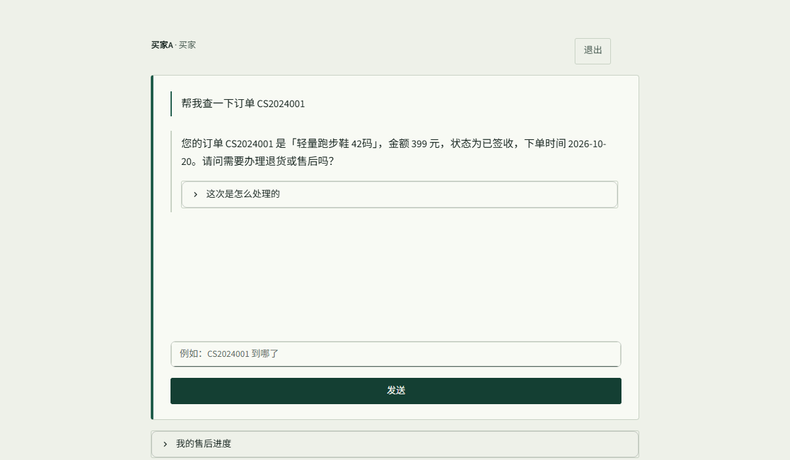
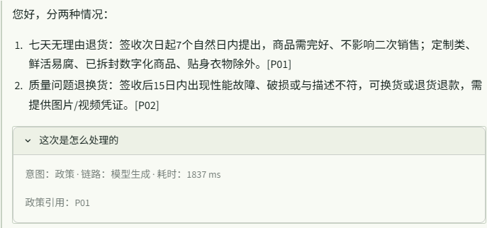

# 电商售后客服 Agent（E-commerce After-Sales Support Agent）

[](https://github.com/actionboy11/ecom-cs-agent/actions/workflows/ci.yml)

**一个能上生产的售后客服 Agent 参考实现**：LangGraph 编排 + MCP 工具化 + 资源级鉴权 + 三层可复现评测。

> 不是又一个 RAG 客服 demo。这个项目回答一个具体问题：**当 AI 客服出错时，系统怎么办？**

**仓库**：https://github.com/actionboy11/ecom-cs-agent ｜ [规格书](docs/SPEC.md) ｜ [项目总报告](docs/PROJECT-REPORT.md) ｜ [词汇表](GLOSSARY.md) ｜ [每日开发记录](docs/daily/) ｜ [决策记录](docs/adr/)

---

## 为什么做这个项目

调研了 12 个 GitHub 同类项目（见 [对标笔记](docs/daily/2026-11-02.md)）后发现三个空白：

| 空白 | 本项目怎么做 |
|---|---|
| 几乎都没做**资源级鉴权**（有项目在 README 自认 `user_id` 未认证） | JWT + 订单归属校验 + 越权统一 404 + 审计 |
| 很少有**失败路径**的演示（只演示成功对话） | 转人工中断/恢复、工具降级、写操作审批、拒答边界 |
| **评测**要么缺失、要么自建自测 | 公开 600 条基准 + 自建 60 条（含 holdout）+ 真实对话质量评测 |

## 架构

```
用户浏览器
   │
   ▼
Streamlit（双栏：买家对话 / 坐席审批）
   │
   ▼
Python: FastAPI + LangGraph
  ├─ classify → knowledge(Chroma) / tools / handoff
  ├─ checkpointer(SQLite)：会话续跑
  ├─ interrupt：转人工审批
  └─ Trace(JSONL)
   │ MCP（工具调用，user_id 由服务端注入，模型不可见）
   ▼
Java: Spring Boot 3 + Spring Security(JWT) + MyBatis-Plus
  ├─ 订单 / 物流 / 退款 / 商品 / 审计
  └─ Flyway 迁移 + MySQL
```

## 五个演示场景

1. **查物流**：多轮补槽 → 工具调用 → 轨迹 + 超时提示
2. **申请退款**：校验政策 → 创建 PENDING → 坐席审批 → 状态回写
3. **投诉**：情绪触发 → 先落盘再中断 → 恢复
4. **商品咨询**：参数/尺码/库存 → 商品工具
5. **越权尝试**：查他人订单 → 404 + 审计 DENIED

## 快速开始

```bash
cp .env.example .env        # 填 DEEPSEEK_API_KEY / JWT_SECRET / INTERNAL_AUDIT_TOKEN
docker compose up -d         # MySQL + Java + Python Agent + 工作台
# 浏览器打开 http://localhost:8501
```

演示流程见 [docs/DEMO.md](docs/DEMO.md)；镜像命名、推送与回滚见 [docs/DEPLOY.md](docs/DEPLOY.md)；开发排期见 [SPEC 第 12 节](docs/SPEC.md)。

## 录屏清单（5 分钟）

1. 终端 `docker compose ps`：mysql / java-service / python-agent / workbench 四个 healthy
2. 买家登录 + S1 查物流
3. S2 退款申请（展示售后请求编号与 PENDING）
4. S3 投诉 → 「已转接人工坐席」
5. S4 商品咨询（建过索引时放大 `[P0x]`）
6. S5 越权 → 统一「没有找到对应的记录」
7. 坐席侧审计面板 + 结尾一页评测数字

详细输入、预期与兜底见 [docs/DEMO.md](docs/DEMO.md)。

## 工作台（React + Vite）



视觉方向是「售后调度台」：灰绿档案纸 + 邮路绿 + 铅线分隔，唯一的暖色（印章朱）只给越权/驳回这类需要人停一下的状态；标题用思源宋体，正文用思源黑体，对话做成连续工单而不是气泡墙。

**单窗口**：买家打开就是一个对话窗口，每个用户固定一个会话，登录会自动带回历史；坐席登录后在同一位置看到售后审批、转接待办、审计三个页签。`docker compose up -d` 已包含该服务（<http://localhost:8501>）。

**两种 Agent 模式**：

- `REACT_ENABLED=false`：确定性 workflow（意图分类 → 固定工具路由 → 回复）
- `REACT_ENABLED=true`：ReAct 主循环，LLM 自主选读工具/参数、失败换工具；退款调用前 interrupt，买家逐次确认后执行

订单匹配走「身份 → 候选召回 → 打分 → 消歧」：`find_my_orders` 在 Java 侧按商品/时间/状态过滤并返回 `score/reasons`，LLM 只消费候选，不猜订单。`buyer_test` 是 12 单匹配评测账号。

**ReAct MVP 验收**：

| 评测 | 结果 |
|---|---|
| 订单匹配（30 条：商品/时间/状态/多候选/无此商品） | **30/30** |
| ReAct 工具选择（15 条：查单/物流/政策/商品/退款确认） | **15/15** |
| 退款确认 | 取消不落单；确认后创建 REFUND |

样例只有 30+15 条、由我们自己出题，不能替代 100 条封版指标；只用于验证匹配与 ReAct 链路可用。

候选订单在 React 里渲染为可点选卡片（订单号、商品、金额、状态、下单/签收时间、匹配原因），点「选这单」直接把订单号带回 Agent，不再让用户手输。

**P0 稳定性**：

- 相对时间由 Python 统一解析：「上周/昨天/上个月/最近 N 天」→ 绝对日期区间，工具只收 `yyyy-MM-dd`
- ReAct fallback 四类触发：超 6 步、工具连续失败 2 次、无候选、写操作校验失败；前端显示「已切换到确定性流程（原因）」
- 额外兜底：模型异常、空回复也回退


前端是 **React 18 + Vite + TypeScript**，零后端模板：浏览器直接调用 Java / Agent API（已配置 CORS），聊天区滚动由 React 直接控制，不再依赖注入脚本。



每条回复可展开「这次是怎么处理的」：意图、生成链路（模型生成/模板兜底）、工具调用、政策引用、耗时——后端能力在对话里就能看见。

本地开发：

```bash
cd web
npm install
npm run dev        # http://localhost:5173
npm run build      # 产物在 web/dist，compose 的 8501 托管它
```

- 演示账号：`buyer_a` / `cs_agent`，密码均为 `demo123`（种子数据）
- 每条回复可展开「这次是怎么处理的」：意图、链路、工具、引用、耗时
- 买家窗口下方有「我的售后进度」，可查自己售后请求的状态
- 坐席登录后是「售后审批 / 转接待办 / 审计」三个页签，选中待办即可恢复（`/resume` 仅坐席可用）
- `python-agent/ui/` 是早期 Streamlit 原型，保留作参考，不再由 compose 启动


## 评测（持续更新）

| 层 | 数据 | 指标 | 结果 |
|---|---|---|---|
| 标准 | 本地等效用例 600 条（抽样 100；公开集未分发，**无许可**，适配器见下） | 回复符合率（等效用例代理，非 oracle） | 76.0%（100 条抽样） |
| 业务 | 自建 60 条（全量；`--split/--holdout` 可切分） | 意图/工具/回复 | 意图 100% / 工具 98.3% / 回复 80.0% |
| 业务 | 政策类 8 条（标注 `expect_citation`） | **引用命中率（回答正文）** | **100%（8/8）** |
| 业务 | 政策类 8 条 | 检索命中率（主依据） | 100%（8/8） |
| 安全 | 越权 4 条 | 拦截率 + 新增 DENIED 审计 | 100%（4/4；覆盖 3 个目标资源） |
| 安全 | 拒答 9 条（四类） | 回复符合率 | 100%（9/9） |
| 业务 | holdout 12 条（`--judge`） | **LLM judge 解决率（第二轨）** | **66.7%（8/12，deepseek-chat；第一轨 75%）** |

复现（需要 Java 业务系统在线，否则工具类用例会计为失败）：

```bash
uv run python -m eval.run_all --standard-limit 100 --out-dir docs/eval   # 三层（含越权）一次跑完
uv run python -m eval.security_check                 # 只跑 4 条越权 + 审计校验
uv run python -m eval.run_eval --cases eval/business_cases.jsonl
uv run python -m eval.run_eval --cases eval/business_cases.jsonl --split holdout --holdout 0.2 --judge  # 第二轨（需 Key）
uv run python -m eval.public_bench --source <公开集.jsonl>       # 公开集适配（不内置数据）
uv run python -m eval.gen_standard_cases             # 重新生成 600 条等效用例
```

报告写到 `eval/reports/`（不提交）；基线由脚本生成并提交到 `docs/eval/`（`three-layers-*.md`），报告内标注数据来源、链路（LLM/兜底）与许可状态。

### AI 增量对照（规则 vs Agent）

同一套 20 条「AI-only 难题」（模糊指代、多意图、政策例外、自由文本办理、情绪/追问），分别跑规则基线和 Agent，用 judge 判是否解决：

| 方案 | 解决率 |
|---|---|
| 规则基线（关键词 + 正则 + 固定话术 + 候选订单） | 40%（8/20） |
| Agent（补能力 + 确认执行） | 90%（18/20） |
| 增量 | +50 个百分点 |

补的能力：**订单候选检索**（`list_my_orders`，解决「那个耳机」）、**政策例外推理**（拆封/定制/超期/赠品）、**多意图拆解**（退款+催件、投诉+退款）、**确认执行**（先给计划，确认后真正调工具办理）。

多动作会先返回执行计划，用户点「确认执行」后逐个调用工具（退款单、物流查询），再汇总结果。评测时自动确认后取最终结果。

> 这 20 条是开发集，能力是照着它补的，100% 不代表泛化。下一步要用**未参与开发的 held-out 题**复测，避免过拟合。

### Held-out 复测（未参与开发）

另建 20 条未参与开发的题（不同商品、不同说法、含未覆盖边界），只跑一次、不调参：

### 100 条 held-out（最终指标）

50 个真实场景 × 2 种说法，覆盖指代/多动作/例外/动作/情绪/边界；每个场景标注难度、是否含订单号。

| 指标 | 数值 | 95% CI |
|---|---|---|
| 规则基线 | 34% | 25–44% |
| Agent（校准后 judge） | **88%** | 80–93% |
| Agent J2（校准后） | 87% | 79–92% |
| 人工随机抽检（30 条） | **90%（27/30）** | 74–97% |
| 双 judge 一致率 | 93% | — |
| 相对基线 | **+54~56pp** | — |

> 旧「严格 71%」作废：J2 与人工一致率只有 45%，把合理追问/安全转人工判成失败。校准后 J1/J2 与人工随机 30 条的一致率都是 27/30。

人工随机抽检失败 3 条：改地址只转人工没说明、赠品套用 P02、多动作列了订单却没执行。完整报告：`docs/eval/2026-11-15-final-eval.md`。

### 修复后回归（新 15 条，未参与修复）

| 指标 | 数值 |
|---|---|
| 规则基线 | 33% |
| Agent J1 | 87%（13/15） |
| Agent J2 | 73%（11/15） |

剩余失败：多动作只做退款漏催件、拆封例外未解释、退款只让确认未执行。新题只跑一次，未据此调参。

### 催件落地 + 新 12 条回归

催件不再只是话术：新增 `urge_logistics` MCP 工具，落一条 `URGE` 售后请求（V5 迁移），可审批、可审计。

| 指标 | 数值 |
|---|---|
| 规则基线 | 33% |
| Agent J1 | **100%（12/12）** |
| Agent J2 | **100%（12/12）** |

覆盖：单笔催件、退款+催件、两笔退款、单笔退款、换货、拆封例外、赠品、改地址、发票、绕过规则、模糊追问、投诉+退款。样本小，仅作修复后回归，不替代 100 条封版指标。

修完「多动作订单分配 + 例外推理」后，又用**新 12 条**（heldout6，未参与修复）回归：

| 指标 | 数值 |
|---|---|
| 规则基线 | 17% |
| Agent J1 | **100%（12/12）** |
| Agent J2 | **100%（12/12）** |

覆盖：双商品退款+催件、两笔退款、拆封/定制/超期/赠品例外、换货加急、单笔退款、改地址、发票、绕过规则。样本仍小，只说明这两类修复没有回归。


修复后用**第二套全新的 20 题**复测（未参与修复）：

| 方案 | 解决率 |
|---|---|
| 规则基线 | 35%（7/20） |
| Agent | **100%（20/20）** |
| 增量 | **+65 个百分点** |

修复点：
- 订单商品字段是 `item` 不是 `itemName`，且「杯子」要映射到「保温杯」，候选匹配才生效
- 赠品没有政策条款时直接转人工，并明确说「无明确规定」，不再套用 P02
- 「快点/着急」识别为加急；换货缺订单时按商品定位到具体订单，并确定性补上订单号

样本只有 20 条，100% 偏乐观；下一轮改动仍需换新 held-out。

命令：`python -m eval.run_hard --cases heldout_cases.jsonl --out 2026-11-15-heldout`（需要 Java/Agent 在线与模型 Key）。

**数据说明**：公开 600 条售后基准（csnewerst）未随仓库分发、离线无法下载，`eval/standard_cases.jsonl` 是确定性生成的**等效用例**，不是公开集；报告与表格均标注来源。

## 目录

```
java-service/    Spring Boot 业务系统 + 鉴权 + MCP Server
python-agent/    LangGraph Agent + 评测 + Streamlit
data/policies/   售后政策库（12 条）
docs/            SPEC / 每日记录 / 简历
```

## 设计取舍

- **业务数据用 MySQL，Agent 状态用 SQLite**：前者要事务和 join，后者是高频小写入。
- **越权返回 404 而不是 403**：403 会泄露资源是否存在，可被用来枚举。
- **关键词规则只做降级兜底，不计入质量指标**：规则一旦参与评测，就会变成为评测集调参。

## 知识检索（Chroma）

12 条售后政策放在 `data/policies/policies.md`，建立索引：

```bash
ollama pull bge-m3                          # 首次
uv run python -m app.knowledge.ingest --rebuild   # 重建索引（首次或政策更新后）
```

- 索引已存在时必须显式 `--rebuild`；重建前会先算好向量，嵌入失败不会清空现有索引

- 向量库为本地持久化 Chroma（`data/chroma`），embedding 用 Ollama `bge-m3`（1024 维）
- 检索结果带 `[P0x]` 引用，回答里保留编号便于核对
- Chroma 或 Ollama 不可用时自动退化为关键词检索，对话不中断
- Windows 若报 `unable to open database file (code 14)`：系统临时目录不可写，程序已自动把 `TMP/TEMP` 指向仓库内 `.tmp`

## 会话数据保留（TTL）

Agent 会话与轨迹默认保留 **30 天**（`SESSION_TTL_DAYS`），业务审计不受影响（审计在 MySQL，按 365 天保留）。

- 服务启动时自动清理一次；
- 手动执行（先预览，再真删）：

```bash
uv run python -m app.maintenance.cleanup --dry-run   # 只统计
uv run python -m app.maintenance.cleanup             # 实际删除
```

- 每日定时：Linux 用 cron，Windows 用任务计划程序：

```cron
30 3 * * * cd /path/to/python-agent && uv run python -m app.maintenance.cleanup >> retention.log 2>&1
```

Windows（任务计划程序 → 创建基本任务 → 每天 03:30）：

```powershell
pwsh -NoProfile -Command "cd C:\path\to\python-agent; uv run python -m app.maintenance.cleanup"
```

退出码：`0` 成功，`2` 参数/状态库不存在，`3` 执行异常，`4` 文件删除失败（便于 cron 告警）。

## 常见问题

| 现象 | 原因 | 处理 |
|---|---|---|
| Spring Boot 启动报 `Communications link failure` | MySQL 容器没起来；宿主机 3306 被本机 MySQL、3307 常被其他项目容器占用 | 本项目容器映射到 **3308**（`3308→3306`）；先 `docker compose up -d mysql`，等 healthy |
| 测试连到别的库 / `Access denied for user 'xxx'` | 系统里其他项目设置的全局 `SPRING_DATASOURCE_URL` 优先级高于 yml | 已在 surefire 显式覆盖；本地启动应用时用 `--spring.datasource.url=...` 或清掉该变量 |
| 启动 uvicorn 报 `[WinError 10013]` | 端口被占用或被 Windows 动态保留 | 换端口 `--port 8010`；或管理员执行 `net stop winnat` / `net start winnat` |
| Agent 返回「业务系统错误 502」，但 `curl localhost:8080` 正常 | 系统代理把 localhost 也代理走了 | 已通过 `trust_env=False` 规避 |
| `uv` 找不到 | PATH 未刷新 | 重开终端 |

## Roadmap

- [x] W0 脚手架：LangGraph 图 + Java 接口 + 10 条评测
- [x] W1 MySQL + JWT + 资源归属校验（越权 404、审计落库、21+ 用例）
- [ ] W2 Chroma 检索 + MCP 工具化
- [ ] W3 三层评测 + 拒答边界
- [ ] W4 Streamlit 双栏 + Docker 一键启动
- [ ] W5 subgraph 多 Agent + 多模型成本对比
- [ ] W6 技术文章 + 面试题库

---

## English

An after-sales customer-support agent that focuses on what demos usually skip: **failure paths and authorization**.

- **Graph**: LangGraph state machine with checkpointing, human-in-the-loop interrupts, and subgraphs.
- **Tools**: MCP-exposed tools backed by a real Spring Boot service; `user_id` is injected server-side and never exposed to the model.
- **Security**: JWT auth, per-resource ownership checks, 404-on-unauthorized (no existence leak), audit trail.
- **Evaluation**: public 600-case benchmark + 60 hand-written cases with a hold-out split + quality review on real conversations.

See [SPEC.md](docs/SPEC.md) for the full specification.

## License

MIT
